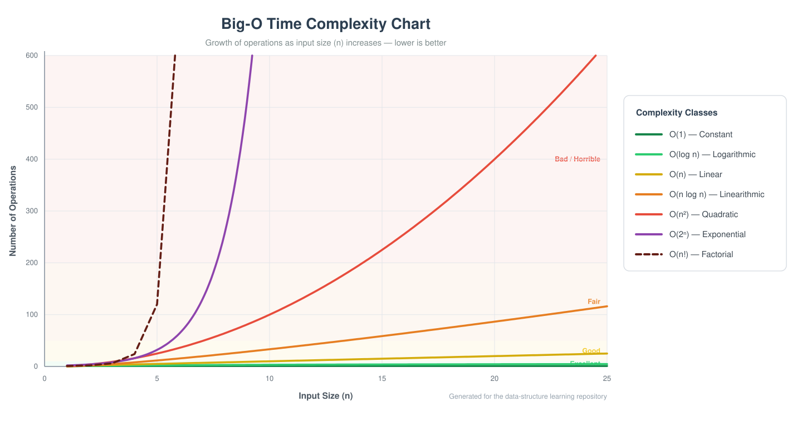

# 📚 Data Structures & Algorithms

> A structured, topic-by-topic repository for learning Data Structures & Algorithms the right way — theory notes, complexity analysis, curated practice problems, and a trackable roadmap — from first principles to interview-ready.

   

---

## 📑 Table of Contents

1. [About This Repository](#about)
2. [Repository Structure](#structure)
3. [Learning Roadmap](#roadmap)
4. [Suggested Study Plans](#study-plan)
5. [Understanding Big-O (Complete Guide)](#big-o)
6. [Time Complexity Cheat Sheets](#cheatsheets)
7. [Problem-Solving Pattern Directory](#patterns)
8. [Choosing the Right Data Structure](#choose-ds)
9. [Algorithm Design Paradigms](#paradigms)
10. [How to Approach Any Problem](#framework)
11. [Interview Preparation](#interview)
12. [How to Use This Repository](#how-to-use)
13. [Progress Tracker](#progress)
14. [Recommended Resources](#resources)
15. [Glossary](#glossary)

---

<a id="about"></a>
## 1. 📖 About This Repository

This repository is a **complete, self-paced curriculum** for mastering Data Structures & Algorithms:

- **15 topic folders**, ordered so each topic builds on the previous one.
- **One `README.md` per topic** — overview, key concepts, complexity tables, variants, essential patterns, curated practice problems with difficulty tags, and pitfalls.
- **A `problems/` folder per topic** — drop your solutions there as you practice.
- **A central cheat-sheet hub** (this file) — Big-O theory, complexity tables for every structure and algorithm family, pattern recognition, and study plans.

It is **language-agnostic**: implement everything in C, C++, Java, Python, JavaScript — whatever you're learning. The concepts transfer completely.

---

<a id="structure"></a>
## 2. 📁 Repository Structure

```text
data-structure/
│
├── README.md                    ← you are here (handbook + cheat sheets)
├── run.sh                       ← compile & run any .cpp from the terminal
├── .gitignore                   ← keeps binaries out of git
├── assets/                      ← diagrams & charts
│   └── big-o-complexity-chart.svg
│
├── 01-arrays/                   ├── 09-heaps/
│   ├── README.md                │   ├── README.md
│   └── problems/                │   └── problems/
│                                ├── 10-tries/
├── 02-strings/                  ├── 11-graphs/
├── 03-linked-lists/             ├── 12-sorting/
├── 04-stacks/                   ├── 13-searching/
├── 05-queues/                   ├── 14-greedy-algorithms/
├── 06-hash-tables/              ├── 15-dynamic-programming/
├── 07-recursion-and-backtracking/
├── 08-trees/
│
│   every topic folder:
│   ├── README.md                ← theory · complexity · patterns · problems
│   └── problems/                ← your solutions (kept in git)
```

---

<a id="roadmap"></a>
## 3. 🗺️ Learning Roadmap

Work through the folders **in numbered order** — every topic builds on the one before it.

| # | Topic | Folder | Core skills you'll gain | Pace |
|:-:|-------|--------|--------------------------|:----:|
| 01 | **Arrays** | [`01-arrays/`](./01-arrays/) | Indexing, two pointers, sliding window, prefix sums | 1 wk |
| 02 | **Strings** | [`02-strings/`](./02-strings/) | Manipulation, frequency counting, window patterns | 1 wk |
| 03 | **Linked Lists** | [`03-linked-lists/`](./03-linked-lists/) | Pointer rewiring, fast & slow, dummy nodes | 1 wk |
| 04 | **Stacks** | [`04-stacks/`](./04-stacks/) | LIFO thinking, matching, monotonic stacks | 3–4 d |
| 05 | **Queues** | [`05-queues/`](./05-queues/) | FIFO thinking, BFS engine, ring buffers, deques | 3–4 d |
| 06 | **Hash Tables** | [`06-hash-tables/`](./06-hash-tables/) | O(1) lookups, counting, grouping, prefix-sum + map | 1 wk |
| 07 | **Recursion & Backtracking** | [`07-recursion-and-backtracking/`](./07-recursion-and-backtracking/) | Recursion trees, choose-explore-undo, pruning | 1–2 wk |
| 08 | **Trees** | [`08-trees/`](./08-trees/) | DFS/BFS traversals, BST logic, recursion on structure | 1–2 wk |
| 09 | **Heaps** | [`09-heaps/`](./09-heaps/) | Priority queues, top-K, two-heaps median | 3–4 d |
| 10 | **Tries** | [`10-tries/`](./10-tries/) | Prefix trees, autocomplete, word search | 3 d |
| 11 | **Graphs** | [`11-graphs/`](./11-graphs/) | BFS/DFS, topo sort, union-find, Dijkstra, MST | 2 wk |
| 12 | **Sorting** | [`12-sorting/`](./12-sorting/) | All classic sorts, stability, trade-off analysis | 1 wk |
| 13 | **Searching** | [`13-searching/`](./13-searching/) | Binary search, boundaries, search-on-answer | 3–4 d |
| 14 | **Greedy Algorithms** | [`14-greedy-algorithms/`](./14-greedy-algorithms/) | Greedy proofs, interval problems, exchange argument | 1 wk |
| 15 | **Dynamic Programming** | [`15-dynamic-programming/`](./15-dynamic-programming/) | States & transitions, knapsack/LCS/LIS families | 2–3 wk |

> 💡 The "Pace" column assumes ~1 hour/day. Going slower is fine — **depth beats speed**.

---

<a id="study-plan"></a>
## 4. 🗓️ Suggested Study Plans

### 📅 Standard plan — 15 weeks (1 hour/day)

| Phase | Weeks | Topics | Milestone |
|:-----:|:-----:|--------|-----------|
| **1 · Foundations** | 1–4 | 01 Arrays → 05 Queues | Solve easy array/string/linked-list problems unaided |
| **2 · Lookups & Hierarchies** | 5–8 | 06 Hash Tables → 09 Heaps | Comfortable with maps, recursion, trees |
| **3 · Networks & Classics** | 9–12 | 10 Tries → 13 Searching | Implement BFS/DFS and binary-search variants cold |
| **4 · Optimization & Mastery** | 13–15 | 14 Greedy, 15 DP + full review | Solve medium problems within 30–35 min |

### ⚡ Accelerated — 8 weeks (2 hours/day)
Two topics per week; do only 🟢 easy problems during the pass, then a second pass for 🟡 mediums in weeks 7–8.

### 🏋️ Deep track — 30 weeks (5–7 hours/week)
One topic per 1–2 weeks: implement every structure from scratch, solve **all** listed problems, and write a short summary of patterns learned in each topic's `problems/NOTES.md`.

### 🔁 Weekly rhythm (any plan)

| Day | Activity |
|-----|----------|
| Mon–Tue | Read the topic README + implement the structure yourself |
| Wed–Fri | Solve problems (easy → medium), one at a time |
| Sat | Re-solve the week's hardest problem from a blank file |
| Sun | Review last week's problems (spaced repetition) |

---

<a id="big-o"></a>
## 5. ⏱️ Understanding Big-O (Complete Guide)

### 5.1 The Complexity Chart



### 5.2 The Notation Classes

| Notation | Name | Doubling n means… | Example |
|:--------:|------|-------------------|---------|
| **O(1)** | Constant | No change | Array index access, hash table lookup, push/pop |
| **O(log n)** | Logarithmic | + 1 more step | Binary search, balanced BST operations |
| **O(n)** | Linear | 2× work | Linear scan, single loop, tree traversal |
| **O(n log n)** | Linearithmic | ~2× work | Merge sort, heap sort, efficient sorting |
| **O(n²)** | Quadratic | 4× work | Bubble sort, nested loops over pairs |
| **O(n³)** | Cubic | 8× work | Triple loops, Floyd-Warshall |
| **O(2ⁿ)** | Exponential | Squared work | Subset enumeration, naive recursion |
| **O(n!)** | Factorial | Explosive growth | Generating all permutations |

### 5.3 What the numbers actually feel like

| n | O(log n) | O(n) | O(n log n) | O(n²) | O(2ⁿ) |
|---:|---:|---:|---:|---:|---:|
| 10 | 3 | 10 | 33 | 100 | 1,024 |
| 100 | 7 | 100 | 664 | 10,000 | 1.3 × 10³⁰ |
| 1,000 | 10 | 1,000 | 9,966 | 10⁶ | ~10³⁰¹ |
| 10,000 | 13 | 10,000 | 1.3 × 10⁵ | 10⁸ | — |
| 1,000,000 | 20 | 10⁶ | 2 × 10⁷ | 10¹² | — |

**Rule of thumb:** a computer performs roughly **10⁸ simple operations per second**. At n = 1,000,000: an O(n) pass takes ~10 ms, O(n log n) takes ~0.2 s, but O(n²) takes **~3 hours**. Complexity class is not a technicality — it's the difference between shipping and timing out.

### 5.4 Constraints tell you the intended complexity

When a problem states its input size, it's secretly telling you what complexity to aim for *(community rule of thumb)*:

| Input size (n ≤) | Intended complexity | Typical approach |
|:----------------:|:-------------------:|------------------|
| 10–12 | O(n!) | Permutation backtracking |
| 20–25 | O(2ⁿ) | Bitmask DP, subsets |
| 300–500 | O(n³) | Interval DP, Floyd-Warshall |
| 3,000–5,000 | O(n²) | Pairwise DP, nested loops |
| 10⁵–10⁶ | O(n log n) or O(n) | Sorting, heaps, hashing, one pass |
| 10⁸ | O(n) / O(log n) | Math, binary search |

### 5.5 Big-O vs Big-Θ vs Big-Ω

| Symbol | Meaning | Reads as |
|:------:|---------|----------|
| **O** (omicron) | Upper bound | "Never worse than…" |
| **Ω** (omega) | Lower bound | "At least…" |
| **Θ** (theta) | Tight bound | "Exactly this order" |

In practice, interviewers say "Big-O" but mean the **tight bound**: merge sort is O(n log n) *and* Ω(n log n), so it's Θ(n log n). Quick sort is Θ(n log n) on average but O(n²) in the worst case.

### 5.6 Rules for computing Big-O

1. **Drop constants** — O(3n) → O(n); O(½ n²) → O(n²).
2. **Drop lower-order terms** — O(n² + n + 40) → O(n²).
3. **Sequential blocks add** (keep the largest); **nested blocks multiply**.
4. **Different inputs get different variables** — two arrays of size n and m is O(n + m) for a merged scan, O(n·m) for nested loops — *not* O(n²).
5. **Count hidden costs** — string concatenation in a loop, slicing, hash rehashing, copying.

### 5.7 Code shape → complexity

| Code shape | Complexity |
|------------|:----------:|
| Single loop over n | O(n) |
| Two sequential loops over n | O(n) — not O(2n) |
| Nested loops (n × n) | O(n²) |
| Loop that halves / doubles (i *= 2) | O(log n) |
| Loop that halves per outer element | O(n log n) |
| Recursion: one call, half input, O(1) work | O(log n) |
| Recursion: two calls, half input, O(n) merge | O(n log n) |
| Recursion: two calls, n−1 shrink | O(2ⁿ) |
| Recursion + memo over n states, O(1) per state | O(n) |

### 5.8 Classic recurrences (worth memorizing)

| Recurrence | Result | Classic example |
|------------|:------:|-----------------|
| T(n) = T(n/2) + O(1) | O(log n) | Binary search |
| T(n) = T(n/2) + O(n) | O(n) | Quickselect (average) |
| T(n) = 2T(n/2) + O(n) | O(n log n) | Merge sort |
| T(n) = 2T(n/2) + O(1) | O(n) | Tree traversal (balanced) |
| T(n) = T(n−1) + O(n) | O(n²) | Quick sort worst case |
| T(n) = 2T(n−1) + O(1) | O(2ⁿ) | Naive subsets |

### 5.9 Space complexity & amortized cost

- **Space** counts extra memory: auxiliary arrays, the recursion call stack (O(depth)), memo tables, output.
- **Amortized** cost = expensive operation averaged over many cheap ones. Dynamic-array append is O(1) amortized: most appends are O(1); every ~n appends, one O(n) resize happens.
- In-place algorithms use O(1) extra space (e.g., heap sort). Recursive algorithms "hide" O(depth) space in the call stack — mention it in interviews.

---

<a id="cheatsheets"></a>
## 6. 📊 Time Complexity Cheat Sheets

### 6.1 Data structure operations *(average / worst case)*

| Data structure | Access | Search | Insert | Delete |
|----------------|:------:|:------:|:------:|:------:|
| **Array** | O(1) / O(1) | O(n) / O(n) | O(n) / O(n) | O(n) / O(n) |
| **Dynamic array** | O(1) / O(1) | O(n) / O(n) | O(1)* / O(n) | O(n) / O(n) |
| **Stack** | O(n) / O(n) | O(n) / O(n) | O(1) / O(1) | O(1) / O(1) |
| **Queue** | O(n) / O(n) | O(n) / O(n) | O(1) / O(1) | O(1) / O(1) |
| **Singly linked list** | O(n) / O(n) | O(n) / O(n) | O(1) / O(1) | O(1) / O(1) |
| **Doubly linked list** | O(n) / O(n) | O(n) / O(n) | O(1) / O(1) | O(1) / O(1) |
| **Skip list** | O(log n) / O(n) | O(log n) / O(n) | O(log n) / O(n) | O(log n) / O(n) |
| **Hash table** | — | O(1) / O(n) | O(1) / O(n) | O(1) / O(n) |
| **Binary search tree** | O(log n) / O(n) | O(log n) / O(n) | O(log n) / O(n) | O(log n) / O(n) |
| **Balanced tree** (AVL / Red-Black) | O(log n) / O(log n) | O(log n) / O(log n) | O(log n) / O(log n) | O(log n) / O(log n) |
| **B-Tree** | O(log n) / O(log n) | O(log n) / O(log n) | O(log n) / O(log n) | O(log n) / O(log n) |
| **Binary heap** | O(1)† / O(1)† | O(n) / O(n) | O(log n) / O(log n) | O(log n) / O(log n) |
| **Trie** | O(k) / O(k) | O(k) / O(k) | O(k) / O(k) | O(k) / O(k) |

> \* Amortized (occasional resize costs O(n)). † Peeking the min/max only. **k** = length of the key.
> Linked-list insert/delete are O(1) **when you already hold a reference** to the position.

### 6.2 Sorting algorithms

| Algorithm | Best | Average | Worst | Space | Stable? |
|-----------|:----:|:-------:|:-----:|:-----:|:-------:|
| Bubble sort | O(n) | O(n²) | O(n²) | O(1) | ✅ |
| Selection sort | O(n²) | O(n²) | O(n²) | O(1) | ❌ |
| Insertion sort | O(n) | O(n²) | O(n²) | O(1) | ✅ |
| Merge sort | O(n log n) | O(n log n) | O(n log n) | O(n) | ✅ |
| Quick sort | O(n log n) | O(n log n) | O(n²) | O(log n) | ❌ |
| Heap sort | O(n log n) | O(n log n) | O(n log n) | O(1) | ❌ |
| Counting sort | O(n + k) | O(n + k) | O(n + k) | O(k) | ✅ |
| Radix sort | O(n·k) | O(n·k) | O(n·k) | O(n + k) | ✅ |
| Bucket sort | O(n + k) | O(n + k) | O(n²) | O(n) | ✅ |
| **Built-in sorts** | — | — | — | — | Python/Java Timsort ✅ · C++ introsort ❌ |

### 6.3 Searching algorithms

| Algorithm | Best | Average | Worst | Space | Requirement |
|-----------|:----:|:-------:|:-----:|:-----:|-------------|
| Linear search | O(1) | O(n) | O(n) | O(1) | None |
| Binary search | O(1) | O(log n) | O(log n) | O(1) | Sorted input |
| Jump search | O(1) | O(√n) | O(√n) | O(1) | Sorted input |
| Interpolation search | O(1) | O(log log n) | O(n) | O(1) | Sorted + roughly uniform |
| Exponential search | O(1) | O(log n) | O(log n) | O(1) | Sorted / unbounded input |
| Binary search on answer | — | O(n · log R) | O(n · log R) | O(1) | Monotone feasibility |

### 6.4 Graph algorithms

| Algorithm | Time | Space | Solves | Notes |
|-----------|:----:|:-----:|--------|-------|
| BFS | O(V + E) | O(V) | Shortest path (unweighted), levels | Queue |
| DFS | O(V + E) | O(V) | Components, cycles, topo order | Stack / recursion |
| Topological sort | O(V + E) | O(V) | Dependency order (DAG) | Kahn's or DFS |
| Union-Find (DSU) | ≈ O(α(n)) / op | O(V) | Connectivity, cycles, MST helper | Path compression + rank |
| Dijkstra | O((V + E) log V) | O(V + E) | Shortest path, non-negative weights | Min-heap |
| Bellman-Ford | O(V · E) | O(V) | Shortest path with negative edges | Detects negative cycles |
| Floyd-Warshall | O(V³) | O(V²) | All-pairs shortest paths | DP over k, i, j |
| Kruskal (MST) | O(E log E) | O(V) | Minimum spanning tree | Sort edges + DSU |
| Prim (MST) | O(E log V) | O(V + E) | Minimum spanning tree | Min-heap |

### 6.5 Common operation complexities

| Operation | Complexity |
|-----------|:----------:|
| Hash map get / set | O(1) avg |
| Sort n items | O(n log n) |
| Heap push / pop | O(log n) |
| Build heap from array | O(n) |
| BST search (balanced) | O(log n) |
| Merge two sorted lists | O(n + m) |
| String concat / slice of length k | O(k) |
| All pairs / all triplets | O(n²) / O(n³) |
| All subsets / all permutations | O(2ⁿ·n) / O(n!·n) |

---

<a id="patterns"></a>
## 7. 🧩 Problem-Solving Pattern Directory

**Recognizing the pattern is 80% of solving the problem.** When a problem mentions the left column, reach for the right one.

| If the problem says… | Reach for | Topic |
|----------------------|-----------|:-----:|
| "sorted array" | Binary search · two pointers | [13](./13-searching/) |
| "contiguous subarray / substring" + "longest / shortest / max sum" | Sliding window | [01](./01-arrays/) · [02](./02-strings/) |
| "sum of a range, many queries" | Prefix sums | [01](./01-arrays/) |
| "pairs / triplets that satisfy…" | Sort + two pointers | [01](./01-arrays/) |
| "have I seen this before? / count occurrences" | Hash set / hash map | [06](./06-hash-tables/) |
| "top K / K-th largest / most frequent" | Heap of size K | [09](./09-heaps/) |
| "median of a stream / balanced halves" | Two heaps | [09](./09-heaps/) |
| "next greater / smaller element" | Monotonic stack | [04](./04-stacks/) |
| "matching brackets / undo / nesting" | Stack | [04](./04-stacks/) |
| "reverse a list / detect cycle / find middle" | Fast & slow pointers · in-place reversal | [03](./03-linked-lists/) |
| "least recently used (LRU)" | Hash map + doubly linked list | [06](./06-hash-tables/) |
| "all combinations / permutations / subsets" | Backtracking | [07](./07-recursion-and-backtracking/) |
| "tree traversal / level by level" | DFS recursion · BFS queue | [08](./08-trees/) |
| "words sharing prefixes / autocomplete" | Trie | [10](./10-tries/) |
| "connected regions / islands / grid fill" | Flood fill (BFS/DFS) | [11](./11-graphs/) |
| "shortest path / fewest steps" (unweighted) | BFS | [11](./11-graphs/) |
| "shortest path" (weighted) | Dijkstra | [11](./11-graphs/) |
| "task dependencies / build order / prerequisites" | Topological sort | [11](./11-graphs/) |
| "are these connected? / merge groups" | Union-Find | [11](./11-graphs/) |
| "minimize the maximum / maximize the minimum" | Binary search on answer | [13](./13-searching/) |
| "minimum cost / maximum value with choices" | Dynamic programming | [15](./15-dynamic-programming/) |
| "overlapping intervals / scheduling / meeting rooms" | Sort + greedy sweep | [14](./14-greedy-algorithms/) |
| "take the best local choice each step" (provable) | Greedy | [14](./14-greedy-algorithms/) |

---

<a id="choose-ds"></a>
## 8. 🧭 Choosing the Right Data Structure

| You need… | Use | Why |
|-----------|-----|-----|
| Fast access by position | **Array** | O(1) indexing, cache-friendly |
| Fast lookup by key, order irrelevant | **Hash table** | O(1) average everything |
| Keep keys sorted + range queries | **Balanced BST** (TreeMap / std::map) | O(log n) ordered operations |
| Repeatedly get min / max | **Heap** | O(1) peek, O(log n) update |
| LIFO undo / nesting / matching | **Stack** | O(1) push/pop |
| FIFO fairness / level traversal | **Queue** | O(1) enqueue/dequeue |
| Both ends efficiently | **Deque** | O(1) at both ends |
| Frequent insert/delete at a known position | **Linked list** | O(1) pointer rewiring |
| Fixed buffer with wraparound | **Circular queue** | O(1) operations, bounded memory |
| Prefix matching over many strings | **Trie** | O(k) regardless of store size |
| Priority + fast updates over time | **Indexed heap / TreeSet** | O(log n) with updates |

### Array vs linked list — the classic trade-off

| Criterion | Array | Linked list |
|-----------|-------|-------------|
| Access i-th | **O(1)** | O(n) |
| Insert/delete middle | O(n) shift | **O(1)** with node reference |
| Memory | Compact, contiguous | Pointer overhead per node |
| Cache behavior | **Excellent** | Poor (scattered nodes) |
| Growth | Resize (amortized O(1)) | **Always O(1)** per node |

---

<a id="paradigms"></a>
## 9. 🛠️ Algorithm Design Paradigms

| Paradigm | Core idea | Use when | Representatives |
|----------|-----------|----------|-----------------|
| **Brute force** | Try everything | n is tiny, or as a baseline | Subsets by enumeration |
| **Divide & conquer** | Split → solve → merge | Subproblems independent | Merge sort, quick sort, binary search |
| **Greedy** | Best local choice, never revisit | Greedy choice provable | Activity selection, Huffman, Dijkstra |
| **Dynamic programming** | Overlapping subproblems, cached | Choices with overlapping states | Knapsack, LCS, edit distance |
| **Backtracking** | Choose → explore → undo | Exhaustive search with pruning | N-Queens, Sudoku, word search |
| **Two pointers / windows** | Exploit structure to avoid rework | Sorted or contiguous data | Pair sums, substring windows |
| **Bit manipulation** | Treat numbers as bitsets | n ≤ ~30, sets, XOR tricks | Single number, bitmask DP |

**Greedy vs DP — the acid test:** if making the locally best choice can ever lock you out of the global optimum, it's DP; if a short exchange argument proves local = global, it's greedy.

---

<a id="framework"></a>
## 10. 🧠 How to Approach Any Problem

Follow this sequence every time — it turns "I'm stuck" into a repeatable process.

1. **Understand** — restate the problem in your own words. What's the input, output, and the exact constraint?
2. **Examples** — write 2–3 examples yourself, including an edge case (empty, single element, duplicates, negatives).
3. **Brute force first** — state the naive solution and its complexity out loud. It's your baseline and often the seed of the optimized version.
4. **Spot the pattern** — scan the [Pattern Directory](#patterns). What does the input hint at (sorted? tree? graph? top-K?)
5. **Optimize before coding** — identify the wasted work in the brute force. Can hashing remove a loop? Sorting enable two pointers? Memoization collapse the recursion tree?
6. **Code it** — only after the approach is clear. Name variables well; handle boundaries explicitly.
7. **Test & state complexities** — trace an example, check the edge cases, then declare time and space complexity *with a reason*.

> ⏱️ **Time-box:** if stuck for 25–30 minutes with zero progress, read the hint or solution — actively (close it and re-implement from memory). Getting stuck isn't failure; staying stuck is.

---

<a id="interview"></a>
## 11. 🎤 Interview Preparation

### Practice discipline

- **Consistency over intensity** — 1–2 focused problems daily beats a 10-problem weekend binge.
- **Pattern per problem** — after solving, write one line: *which pattern* and *what was the signal*. Keep a personal pattern journal.
- **Spaced repetition** — re-solve each problem after 3 days, then after a week. Recognizing ≠ reproducing.
- **Medium is the target** — interviews live at 🟡 Medium level. Master those before chasing 🔴 Hards.
- **Verbalize** — explain your approach aloud while coding; interviews grade communication equally.

### The interview arc

| Stage | Time | What to do |
|-------|:----:|------------|
| Clarify | 2–3 min | Restate, ask about constraints, edge cases |
| Approach | 5 min | Brute force → optimized; get buy-in before coding |
| Code | 15–20 min | Clean, incremental, narrated |
| Test | 5 min | Trace an example + edge cases |
| Analyze | 2–3 min | Time & space complexity with justification |

### Signals of a strong answer

- States complexity **without being asked**.
- Handles empty/single/duplicate inputs unprompted.
- Knows the built-in structures of their language cold (complexity included).
- Offers a second approach and can compare trade-offs.

---

<a id="how-to-use"></a>
## 12. 🧭 How to Use This Repository

1. **Read** the `README.md` inside a topic folder — theory, complexity tables, and patterns.
2. **Implement** each data structure from scratch in your language of choice — the real learning happens here.
3. **Solve** the listed problems into that topic's `problems/` folder:
   - Naming: `two_sum.cpp`, `reverse_linked_list.cpp`, `valid_parentheses.java` (any language works)
   - Add a short header comment: pattern used + complexity.
4. **Write** a `problems/NOTES.md` per topic — what clicked, what didn't (your future self will thank you).
5. **Revisit** — re-solve problems after a week; spaced repetition is how patterns stick.
6. **Track** — tick items in the [Progress Tracker](#progress).

> ⚡ **C++ workflow (VS Code):** this repo ships `.vscode/tasks.json` — open any `.cpp` file inside a topic's `problems/` folder, then **Terminal → Run Task → "C++: Run Current File"**. It compiles with `g++ -std=c++17 -Wall -Wextra -g` and executes in one step, with the `.exe` placed beside your source (binaries are git-ignored, so the repo stays clean).

### 🖥️ Terminal workflow (`run.sh`)

The same build, straight from **Git Bash / Linux / macOS** — with debug, release, and sanitizer modes plus smart rebuilds (it only recompiles when the source changed):

```bash
./run.sh 01-arrays/problems/two_sum.cpp            # debug build + run
./run.sh -r 01-arrays/problems/two_sum.cpp         # release build (-O2)
./run.sh -s 07-recursion-and-backtracking/problems/n_queens.cpp   # AddressSanitizer + UBSan
./run.sh 01-arrays/problems/two_sum.cpp input.txt  # args after the file → your program
./run.sh --clean 01-arrays/problems/two_sum.cpp    # remove the compiled binary
./run.sh --help                                    # all options
```

> The binary lands next to your source (git-ignored), and the script mirrors the VS Code task's flags — pick whichever workflow suits the moment.

---

<a id="progress"></a>
## 13. ✅ Progress Tracker

**Phase 1 — Foundations**

- [ ] 01 · Arrays
- [ ] 02 · Strings
- [ ] 03 · Linked Lists
- [ ] 04 · Stacks
- [ ] 05 · Queues

**Phase 2 — Lookups & Hierarchies**

- [ ] 06 · Hash Tables
- [ ] 07 · Recursion & Backtracking
- [ ] 08 · Trees
- [ ] 09 · Heaps

**Phase 3 — Networks & Classics**

- [ ] 10 · Tries
- [ ] 11 · Graphs
- [ ] 12 · Sorting
- [ ] 13 · Searching

**Phase 4 — Optimization & Mastery**

- [ ] 14 · Greedy Algorithms
- [ ] 15 · Dynamic Programming
- [ ] 🔁 Full review pass (all mediums from a blank file)
- [ ] 🎤 3 mock interviews

---

<a id="resources"></a>
## 14. 📚 Recommended Resources

### Books

| Level | Book | Best for |
|-------|------|----------|
| 📗 Beginner | *Grokking Algorithms* — Aditya Bhargava | Intuition, illustrated, gentle start |
| 📘 Interview | *Cracking the Coding Interview* — G. L. McDowell | The interview process + 189 problems |
| 📗 Interview | *Elements of Programming Interviews* | Tighter, more rigorous problem sets |
| 📕 Reference | *Introduction to Algorithms* (CLRS) | The encyclopedia — proofs & depth |

### Courses & videos

| Resource | Format | Strength |
|----------|--------|----------|
| [NeetCode.io](https://neetcode.io) | Free videos | Pattern-first teaching, best curated roadmap |
| Abdul Bari's Algorithms (YouTube) | Free videos | Clear theory (DP, greedy, graphs) |
| MIT 6.006 *Introduction to Algorithms* | Free lectures | Rigorous academic foundation |
| William Fiset — Data Structures (YouTube) | Free videos | Deep coverage incl. graphs & tries |
| Princeton Algorithms I & II (Coursera) | Free course | Java-based, classic curriculum |

### Practice platforms

| Platform | Use it for |
|----------|------------|
| [LeetCode](https://leetcode.com) | The interview standard — filter by topic & difficulty |
| [NeetCode 150](https://neetcode.io/practice) | Curated 150-problem ladder matching this roadmap |
| [HackerRank](https://hackerrank.com) | Language warm-ups, structured tracks |
| [Codeforces](https://codeforces.com) / [AtCoder](https://atcoder.jp) | Speed & competitive rigor |

### Visualizers

| Tool | Use |
|------|-----|
| [VisuAlgo](https://visualgo.net) | Animated structures & algorithms |
| [Algorithm Visualizer](https://algorithm-visualizer.org) | Interactive code + animation |
| [Big-O Cheat Sheet](https://www.bigocheatsheet.com) | Complexity tables at a glance |
| [USFCA animations](https://www.cs.usfca.edu/~galles/visualization/Algorithms.html) | Per-structure interactive visuals |

---

<a id="glossary"></a>
## 15. 📇 Glossary

<details>
<summary><strong>Click to expand — 24 essential terms</strong></summary>

| Term | Meaning |
|------|---------|
| **Amortized** | Average cost per operation over a worst-case sequence (dynamic array append) |
| **Adjacency list** | Graph stored as per-node neighbor lists — O(V + E) space |
| **Balanced tree** | Subtree heights differ by ≤ 1 everywhere → O(log n) guaranteed |
| **Base case** | The directly-answerable input that stops recursion |
| **Complete tree** | All levels full except possibly the last, filled left-to-right |
| **Deque** | Double-ended queue — O(1) insert/remove at both ends |
| **DFS / BFS** | Depth-first (stack/recursion) vs breadth-first (queue) traversal |
| **Dynamic programming** | Solving overlapping subproblems once and reusing answers |
| **Exchange argument** | Proof technique for greedy: swap any optimal toward greedy without loss |
| **Greedy choice property** | Local optimum implies global optimum — greedy's license to operate |
| **Hash collision** | Two keys mapping to the same bucket |
| **Heap property** | Parent ≤ children (min-heap) or ≥ children (max-heap) |
| **In-place** | O(1) extra memory (beyond recursion stack) |
| **Load factor** | entries ÷ capacity of a hash table; triggers rehash past ~0.7 |
| **Memoization** | Top-down caching of recursive results |
| **Monotonic stack** | Stack kept sorted while scanning — next-greater-element queries |
| **Optimal substructure** | Optimal solution builds from optimal solutions of subproblems |
| **Pivot** | Partition element in quick sort / quickselect |
| **Prefix sum** | Running totals enabling O(1) range-sum queries |
| **Recurrence** | Formula defining T(n) in terms of smaller inputs |
| **Stable sort** | Equal keys keep their original relative order |
| **Tabulation** | Bottom-up DP: fill the table from base cases up |
| **Topological order** | Linear order of a DAG where every edge points forward |
| **Two pointers** | Two indices moving cooperatively (opposite ends, or trailing) |

</details>

---

> 💬 **Remember:** understanding *why* a structure works beats memorizing it. Code every structure from scratch at least once — the concepts transfer to every language you'll ever use.
